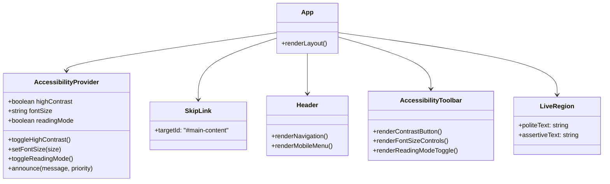
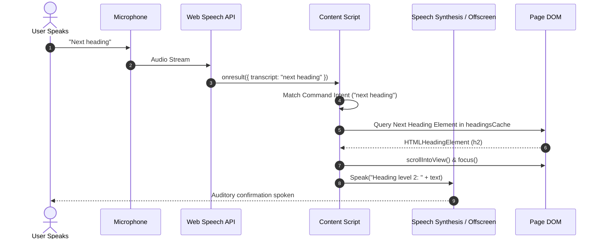
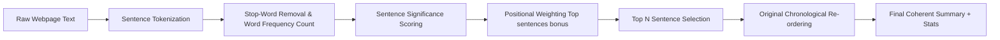

# System Design Document (SDD)
## AccessVision: System Architecture & Technical Design

**Document Version:** 1.0.0  
**Target Environment:** Cross-Browser (Chromium, Gecko, WebKit) & Node.js Runtime  
**Design Standard:** IEEE 1016-2009 (System Design Description)  

---

## 1. Architectural Overview

The **AccessVision** platform employs a modular, decoupled tri-tier architecture engineered for high performance, low latency, and uncompromising accessibility:

1. **Presentation & Application Layer (AccessVision Hub)**: A modern Single-Page Application (SPA) built using React 18, TypeScript, and Tailwind CSS.
2. **Client-Side Assistive Augmentation Layer (AccessVision Assistant)**: A Manifest V3 browser extension injecting non-destructive scripts and styles, utilizing a dedicated audio offscreen document (`offscreen/`) to ensure high-fidelity multilingual speech playback without host-page CSP or autoplay interference.
3. **Intelligence & Processing Service (AccessVision Backend)**: A flexible dual-engine microservice (standalone zero-dependency Python 3.8+ server or Node.js/Express service) handling NLP extractive TextRank summarization, contextual image alt-text generation, and automated WCAG 2.2 accessibility audits.

```mermaid
graph TB
    subgraph Client Browser Host
        subgraph Webpage DOM
            P1[Target Webpage HTML]
            CS[AccessVision Content Script]
            CS_CSS[Injected High-Contrast & Reading CSS]
            CS -->|Inspects & Enriches| P1
            CS_CSS -->|Styles Overrides| P1
        end

        subgraph Extension Process (Manifest V3)
            SW[Background Service Worker]
            Popup[Extension Action Popup]
            Options[Options Management Page]
            Offscreen[Offscreen Audio Player Subsystem]
            Storage[(chrome.storage.local)]
            
            Popup <-->|chrome.runtime messaging| SW
            Options <-->|Storage API| Storage
            SW <-->|Storage API| Storage
            SW <-->|chrome.tabs.sendMessage| CS
            SW <-->|chrome.runtime messaging| Offscreen
        end

        subgraph Native Browser APIs
            WS_Rec[SpeechRecognition API]
            WS_Syn[SpeechSynthesis / chrome.tts]
            CS --> WS_Rec
            CS --> WS_Syn
            Offscreen -->|HTML5 Audio Element| AudioDevice[Audio Output Hardware]
        end
    end

    subgraph Backend Microservice (Dual Stack)
        subgraph Python or Node Runtime (Port 3001)
            API[REST API /api]
            NLP[TextRank Extractive Summarizer]
            AltEngine[Contextual Alt-Text Engine]
            AuditEngine[WCAG 2.2 Auditor]
            LiveAI[OpenAI / HuggingFace Connectors]
            
            API --> NLP
            API --> AltEngine
            API --> AuditEngine
            API -.-> LiveAI
        end
    end

    CS <-->|HTTP JSON POST /api| API
```

---

## 2. Component Design & Subsystems

### 2.1 Demo Website Component Hierarchy (React 18 + TypeScript)

The application tree ensures continuous focus preservation and centralized accessibility state broadcasting:



### 2.2 Browser Extension Architecture (Manifest V3)

The extension separates execution concerns across four isolated runtime contexts:

1. **Background Service Worker (`service-worker.js`)**:
   - Executes in an event-driven background thread without persistent memory leakage.
   - Listens for global shortcut triggers (`commands.onCommand`) like `Alt+Shift+V`, `Alt+Shift+C`, `Alt+Shift+R`, `Alt+Shift+S`.
   - Bridges communication between popup, options, content scripts, and the offscreen audio player.
   - Manages offscreen document lifecycle via `chrome.offscreen.createDocument()`.
   - Fetches and chunks Natural Urdu speech streams via Google Translate TTS endpoints, concatenating raw MP3 frames into unified base64 data payloads.
2. **Dedicated Audio Offscreen Document (`offscreen/offscreen.html` & `offscreen/offscreen.js`)**:
   - Runs in a secure extension page context with reason `AUDIO_PLAYBACK`.
   - **Solves Manifest V3 Audio Limitations**: Service workers cannot instantiate the DOM `Audio` constructor, while content scripts are frequently blocked by restrictive host-page Content Security Policies (CSP) or browser autoplay policies.
   - Handles `play`, `pause`, `resume`, `stop`, and playback state inspection (`getStatus`), broadcasting completion and error events back to tabs.
3. **Content Script (`content-script.js` & `content-styles.css`)**:
   - Runs in an isolated world within each webpage tab.
   - Traverses the live DOM tree to extract readable semantic elements, headings, landmarks, forms, and images.
   - Automatically detects Urdu Unicode script (`[\u0600-\u06FF]`) to dynamically select the appropriate speech synthesis voice.
   - Applies synchronized sentence-level visual highlighting (`.av-spoken-highlight`) and smooth scrolling during TTS playback.
   - Injects the floating accessible control widget (`#av-floating-panel`).
   - Hooks into the `webkitSpeechRecognition` API for hands-free voice command listening.
4. **Popup & Options Interfaces (`popup/` & `options/`)**:
   - Provides accessible quick buttons for users who prefer point-and-click or screen reader popup access.
   - Includes speech rate (0.5x–2.0x), pitch (0.5–1.5), and volume (10%–100%) sliders with live voice preview for both English and Urdu.
   - Dynamically updates active states (`aria-pressed`) to reflect the current tab's contrast and reading modes.

---

## 3. Data Flow Pipelines

### 3.1 Voice Command Processing Pipeline



### 3.2 Multilingual Speech & Natural Urdu Audio Pipeline

```mermaid
sequenceDiagram
    autonumber
    actor User as User / Tab
    participant CS as Content Script
    participant SW as Service Worker
    participant ExtAPI as Google TTS / Backend API
    participant Off as Offscreen Document (AUDIO_PLAYBACK)

    User->>CS: Triggers "Read in Urdu" / Urdu detected
    CS->>SW: sendMessage({ action: 'playAudioStream', text, lang: 'ur' })
    SW->>SW: Chunk text on word boundaries (<= 130 chars)
    loop For each chunk
        SW->>ExtAPI: fetch(chunk URL)
        ExtAPI-->>SW: ArrayBuffer (MP3 Frame)
    end
    SW->>SW: Concatenate MP3 frames & encode to base64 Data URL
    SW->>Off: ensureOffscreenDocument()
    SW->>Off: sendMessage({ target: 'offscreen', action: 'play', audioData })
    Off->>Off: new Audio(audioData).play()
    Off-->>User: Crystal-clear continuous Urdu speech audio
    Off->>SW: sendMessage({ action: 'audioPlaybackEnded' })
    SW->>CS: sendMessage({ action: 'audioFinished' })
    CS->>CS: Advance highlight to next paragraph
```

### 3.3 Extractive Summarization Pipeline



---

## 4. Design Patterns Applied

| Pattern | Component | Concrete Implementation |
|---|---|---|
| **Observer Pattern** | Content Script | `MutationObserver` watches for dynamically added DOM elements (modals, infinite scroll) and automatically generates alt-text and announces dynamic updates. |
| **Facade Pattern** | `service-worker.js` & `content-script.js` | Abstracts differences between `chrome.tts` and standard `window.speechSynthesis` behind a unified `speak(text, options)` interface. |
| **Strategy Pattern** | `imageDescriber.js` | Employs a fallback chain of strategies: (1) Figure caption, (2) Parent link destination, (3) Cleaned filename tokenization, (4) Surrounding text context. |
| **Context Provider** | React Website | `AccessibilityContext` maintains global theme state and dispatches live screen reader announcements without prop-drilling. |

---

## 5. Security & Privacy Considerations

1. **Content Security Policy (CSP)**: The extension contains no `eval()` calls or external script tags.
2. **Sanitized DOM Insertion**: All user-controlled and API-returned text strings are injected using `textContent` or text nodes rather than `innerHTML`, eliminating Cross-Site Scripting (XSS) attack vectors.
3. **Local-First Processing**: Speech recognition utilizes browser native engines. Summarization and alt-text extraction occur on localhost or private endpoints without persisting user browsing history.
