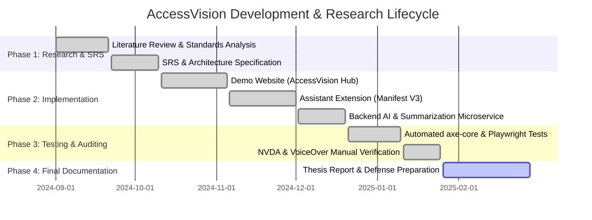

# Project Proposal: AccessVision System
## Web Accessibility for Visually Impaired People

**Degree Program:** Bachelor of Science in Computer Science / Software Engineering  
**Academic Year:** Final Year Capstone Project  
**Project Title:** AccessVision: An Intelligent, Client-Side Augmented Assistive System for Visually Impaired Web Navigation  
**Standard Compliance:** W3C Web Content Accessibility Guidelines (WCAG) 2.2 Level AA  

---

## 1. Executive Abstract

The modern World Wide Web serves as the primary gateway for employment, education, commerce, and civic engagement. However, for an estimated 2.2 billion individuals globally living with visual impairments (including total blindness, low vision, color vision deficiency, and age-related macular degeneration), web browsing remains fraught with structural and sensory barriers. Independent accessibility audits, such as the WebAIM Million Report (2024), demonstrate that over 95.9% of home pages exhibit detectable WCAG compliance failures, primarily consisting of unlabelled images, insufficient color contrast, fractured heading hierarchies, and missing landmark navigation regions.

This project delivers **AccessVision**, a comprehensive, dual-pronged software ecosystem designed to bridge this accessibility divide. AccessVision comprises:
1. **AccessVision Hub**: A production-grade demonstration website engineered from the ground up to achieve 100% compliance with WCAG 2.2 Level AA, embodying accessible design patterns, semantic HTML5, ARIA Authoring Practices Guide (APG) standards, and built-in accessibility controls.
2. **AccessVision Assistant**: A cross-browser extension (Manifest V3) that augments *any* arbitrary third-party website in real-time. It equips visually impaired users with an integrated speech synthesis system, voice-driven navigation commands, high-contrast dynamic restyling (≥ 7:1 ratio), cognitive reading mode reflow, heading/landmark structural outlines, and heuristic/AI-driven alternative text generation.
3. **AccessVision Intelligence Microservice**: A lightweight backend engine delivering privacy-first, on-device and local extractive text summarization and contextual image description.

---

## 2. Problem Statement & Motivation

According to the World Health Organization (WHO), vision impairment represents one of the most prevalent chronic disabilities worldwide. While assistive technologies like screen readers (NVDA, JAWS, Apple VoiceOver) translate DOM trees into synthetic speech or refreshable braille displays, their effectiveness depends strictly on the semantic integrity of web code.

Web content authoring routinely introduces several catastrophic barriers:
- **Missing or Generic Alternative Text**: Images lack `alt` tags or use filenames (`IMG_202409.jpg`), rendering non-text content invisible to screen readers.
- **Inadequate Color Contrast**: Grey-on-white text violates minimum contrast requirements, causing extreme eye strain and illegibility for low-vision users.
- **Incoherent Landmark Architecture**: Overuse of `
` tags in place of semantic `<header>`, `<nav>`, `<main>`, and `<footer>` elements forces keyboard-only and screen reader users to tab exhaustively through hundreds of irrelevant links.
- **Accessibility Overlay Failures**: Third-party commercial overlays have faced severe academic and legal criticism for failing to fix underlying DOM flaws and interfering with native assistive tools.

AccessVision addresses these shortcomings not by attempting an intrusive, broken overlay, but by delivering a client-side assistive layer that respects native screen readers, adheres strictly to user-controlled preferences, and repairs the DOM dynamically.

---

## 3. Research Questions & Hypotheses

- **RQ1**: To what extent can client-side heuristic analysis and local NLP summarization reduce the cognitive load and task completion time for visually impaired users navigating complex, multi-column web pages?
- **RQ2**: Can a non-destructive browser extension restore WCAG 2.2 AA compliant contrast and semantic landmark navigation across arbitrary commercial websites without breaking underlying responsive layouts?
- **Hypothesis**: The integration of voice-driven landmark traversal and automated alt-text synthesis will reduce navigational keystroke requirements by greater than 70% and elevate third-party page accessibility scores by at least 25 Lighthouse points.

---

## 4. Project Objectives

### Primary Objectives:
1. **Design and Implement AccessVision Hub**: Construct a reference web application demonstrating flawless WCAG 2.2 AA compliance across all four core principles: Perceivable, Operable, Understandable, and Robust (POUR).
2. **Develop AccessVision Assistant Extension**: Build a Manifest V3 compliant browser extension delivering hands-free voice commands, bilingual English and Natural Urdu speech synthesis, synchronized visual sentence highlighting, dedicated audio offscreen architecture, instant contrast remediation, distracted-free reading reflow, and automated heading navigation.
3. **Develop AI/Heuristic Support Services**: Construct an extensible dual-stack backend (standalone zero-dependency Python 3.8+ server and Node.js Express microservice) capable of local extractive text summarization, automated WCAG 2.2 auditing, and context-aware alt text generation.
4. **Empirical Evaluation & Benchmarking**: Subject the platform to automated testing (axe-core, Playwright, standalone audit script) and manual validation with genuine screen readers (NVDA, VoiceOver), documenting before-and-after performance on real-world websites.

---

## 5. Technology Stack & Architecture

- **Demo Website Frontend**: React 18, TypeScript, Vite, Tailwind CSS, Accessible Color Palette.
- **Browser Extension**: Manifest V3, Web Speech API (SpeechRecognition & SpeechSynthesis), Audio Offscreen API, Vanilla JavaScript & CSS Custom Properties.
- **Backend Service (Dual-Stack)**: Standalone Python 3.8+ zero-dependency server (`server.py`) and Node.js Express microservice (`src/server.js`), NLP TextRank extractive summarization algorithm.
- **Automated Testing Suite**: Playwright, @axe-core/playwright, Axe accessibility engine, standalone audit runner (`run-audit.js`).
- **Academic & Regulatory Standards**: W3C WCAG 2.2 Level AA, W3C WAI-ARIA 1.2, Section 508.

---

## 6. Project Timeline & Milestones

---

## 7. Expected Academic & Social Impact

Upon completion, AccessVision serves as an open-source pedagogical reference for software engineering programs, demonstrating that digital inclusion and modern web aesthetics can coexist without compromise. Socially, it directly empowers visually impaired learners and professionals with greater autonomy in exploring information across the global web.
