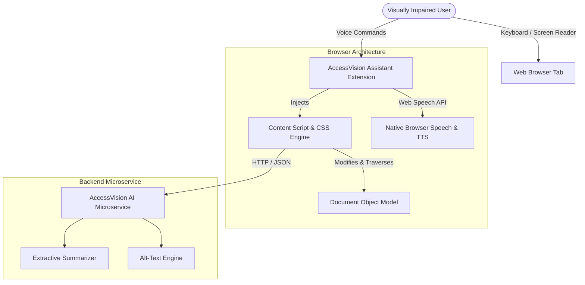
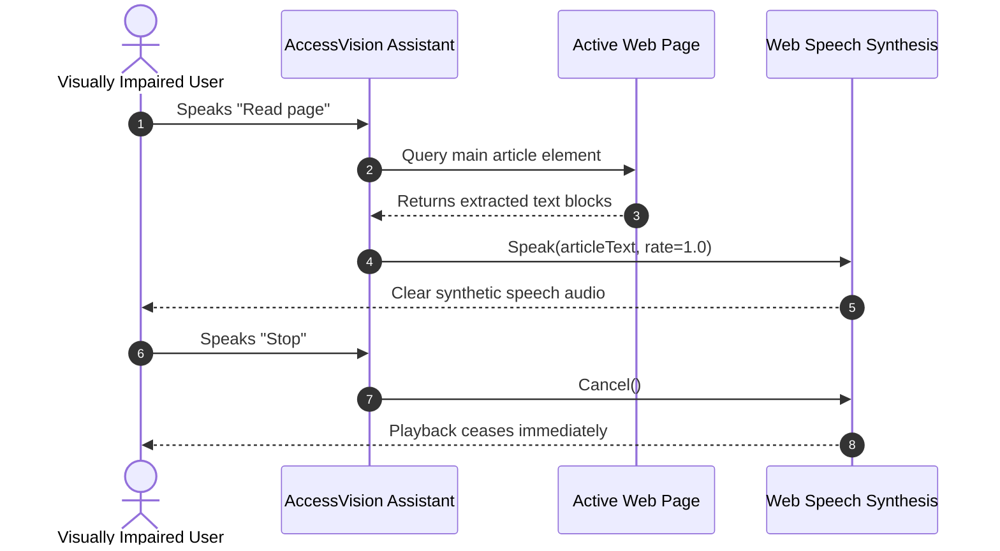

# Software Requirements Specification (SRS)
## AccessVision: Web Accessibility for Visually Impaired People

**Standard:** IEEE Std 830-1998 / ISO/IEC/IEEE 29148:2018  
**Document Version:** 1.0.0  
**Project Lead:** Final Year Capstone Research  
**Status:** Approved & Implemented  

---

## 1. Introduction

### 1.1 Purpose
This document provides a formal and definitive Software Requirements Specification (SRS) for the **AccessVision System**. It defines the functional, non-functional, interface, and behavioral requirements for both the demonstration website (AccessVision Hub) and the client-side browser extension (AccessVision Assistant), together with the AI-assisted backend microservice.

### 1.2 Scope of the System
AccessVision is an integrated accessibility engineering solution designed to eliminate barriers encountered by blind and low-vision individuals when interacting with web applications. The software encompasses:
- A WCAG 2.2 Level AA reference website delivering interactive forms, articles, and built-in accessibility toolbars.
- A Manifest V3 browser extension providing real-time DOM auditing, voice-guided navigation, reading modes, high-contrast theming, and heuristic alt-text synthesis.
- A backend server providing NLP extractive summarization and automated markup validation.

### 1.3 Definitions, Acronyms, and Abbreviations
- **WCAG**: Web Content Accessibility Guidelines (published by W3C WAI).
- **ARIA**: Accessible Rich Internet Applications (W3C standard for enhancing HTML semantics).
- **APG**: ARIA Authoring Practices Guide.
- **AT**: Assistive Technology (screen readers, braille displays, screen magnifiers).
- **DOM**: Document Object Model.
- **POUR**: Perceivable, Operable, Understandable, Robust (the four core principles of WCAG).
- **TTS**: Text-to-Speech synthesis.
- **SRS**: Software Requirements Specification.

### 1.4 References
- W3C Web Content Accessibility Guidelines (WCAG) 2.2 Recommendation (October 2023).
- W3C WAI-ARIA 1.2 Specification (June 2023).
- WebAIM Million Report 2024: Accessibility Analysis of the Top 1,000,000 Home Pages.
- Chrome Extensions Manifest V3 Developer Documentation (Google, 2024).

---

## 2. Overall Description

### 2.1 Product Perspective
AccessVision operates in two modes:
1. **Self-Contained Web Portal (`AccessVision Hub`)**: Acts as a pristine, zero-defect accessibility reference, illustrating best practices in accessible UI engineering.
2. **Ambient Client-Side Extension (`AccessVision Assistant`)**: Runs in the background of Chromium-based browsers, injecting enhancements into third-party web pages without disrupting server infrastructure or violating user privacy.

### 2.2 User Classes & Characteristics
1. **Screen Reader Power Users (Totally Blind)**: Rely strictly on keyboard navigation (Tab, Arrow keys, Heading shortcuts) and synthetic speech audio output. Require semantic HTML landmarks and unambiguous ARIA states.
2. **Low-Vision & Photophobic Users**: Retain partial visual capacity; require high-contrast color schemes (≥ 7:1 ratio), resizable fonts (up to 200% without horizontal scroll), and uncluttered layouts.
3. **Senior Citizens & Motor-Impaired Users**: Experience diminished visual acuity coupled with tremors; benefit from large touch/click targets (≥ 44x44px) and voice-directed navigation.

### 2.3 General Constraints
- **Manifest V3 Conformance**: The extension cannot execute remotely hosted code; all core scripts must be bundled within the package.
- **Client Privacy**: Browsing history and spoken utterances must never be transmitted to third-party ad networks or permanent logs.
- **Performance Overhead**: Injected content scripts must add less than 100 milliseconds to page interaction latency.

---

## 3. Specific Functional Requirements

### 3.1 AccessVision Hub (Demo Website)

#### FR-WEB-01: Bypass Blocks (Skip Navigation)
- **Description**: The site shall provide a visible link allowing users to bypass repetitive navigation links directly to primary content.
- **Input**: User presses `Tab` upon initial page load.
- **Processing**: The `#skip-link` element transitions from visually offscreen to top-left visible focus.
- **Output**: Activating the link (`Enter`) transfers programmatic focus directly to `<main id="main-content">`.
- **WCAG Mapping**: 2.4.1 Bypass Blocks (Level A).

#### FR-WEB-02: Accessibility Toolbar Customization
- **Description**: The website shall feature an interactive floating toolbar to adjust contrast and font sizes.
- **Features**:
  - High Contrast Toggle (inverted dark background with high-luminance amber text).
  - Font Sizing (Small, Normal, Large, Extra Large).
  - Reading Mode (removes headers and footers, centers text in single column).
- **Persistence**: User selections must persist in browser `localStorage` across page navigations.

#### FR-WEB-03: Accessible Form Validation & Error Summary
- **Description**: The contact form shall validate input fields and announce errors non-visually.
- **Behavior**:
  - Missing or invalid fields trigger `aria-invalid="true"`.
  - Error messages are programmatically linked to fields via `aria-describedby`.
  - An `#error-summary` container with `role="alert"` and `aria-live="assertive"` is rendered at the top of the form, focusing the first erroneous field.

### 3.2 AccessVision Assistant (Browser Extension)

#### FR-EXT-01: Voice Recognition & Hands-Free Commands
- **Description**: The extension shall listen for spoken commands via the Web Speech API and execute navigation actions.
- **Supported Phrases**:
  - `"Read page"`: Synthesizes text of main article.
  - `"Read in Urdu"` / `"اردو میں پڑھیں"`: Synthesizes content using high-fidelity Natural Urdu audio.
  - `"Read in English"`: Synthesizes content using natural English voice.
  - `"Pause"` / `"Resume"`: Pauses or resumes speech synthesis and audio streaming.
  - `"Stop"`: Cancels current TTS playback and clears visual highlights.
  - `"Summarize"`: Extracts key sentences and announces summary.
  - `"Next heading"` / `"Previous heading"`: Moves viewport focus to the next/prev `<h[1-6]>`.
  - `"Toggle contrast"` / `"Contrast"`: Inverts high-contrast styles.
  - `"List landmarks"`: Speaks count and roles of all page landmarks.

#### FR-EXT-02: Structural Outline Traversal
- **Description**: The extension shall parse all heading elements (`h1` through `h6`) and landmarks (`banner`, `nav`, `main`, `contentinfo`, `search`, `aside`) in the DOM and provide an interactive navigation directory.

#### FR-EXT-03: Dynamic Alt-Text Generation
- **Description**: The extension shall inspect all `` tags. If an image lacks an `alt` attribute or has empty alt without `aria-hidden="true"`, the system shall synthesize descriptive text using URL tokens, surrounding text, and parent link anchors.

#### FR-EXT-04: Multilingual Speech Synthesis & Urdu Script Detection
- **Description**: The extension shall automatically detect Urdu unicode script (`[\u0600-\u06FF]`) on bilingual or mixed web pages and automatically transition between English and Urdu TTS engines.
- **Urdu TTS Engine**: Words are chunked on grammatical boundaries ($\le 130$ chars) to prevent Google Translate TTS 400 errors, and MP3 binary frames are merged into seamless, uninterrupted audio.

#### FR-EXT-05: Manifest V3 Dedicated Audio Offscreen Subsystem
- **Description**: To comply with Manifest V3 restrictions (where service workers lack DOM audio access) and bypass host-page Content Security Policy (CSP) headers or autoplay gesture blocks, audio streams shall be managed by a dedicated offscreen document (`offscreen/offscreen.html`).
- **Lifecycle**: Managed dynamically via `chrome.offscreen.createDocument({ reasons: ['AUDIO_PLAYBACK'] })`.

#### FR-EXT-06: Synchronized Sentence-Level Visual Highlighting
- **Description**: While reading aloud, the content script shall apply a high-contrast focus indicator (`.av-spoken-highlight`) to the active sentence or paragraph and scroll it smoothly into view.

### 3.3 Backend AI & Accessibility Microservice (Dual-Stack Engine)

The backend service is implemented as a dual-stack architecture:
1. **Zero-Dependency Python Engine (`server.py`)**: Runs on standard Python 3.8+ using `http.server` with no pip packages required.
2. **Node.js + Express Engine (`src/server.js`)**: Alternative Node.js microservice.
Both expose identical REST endpoints on port 3001:

#### FR-SRV-01: Extractive Summarization
- **Endpoint**: `POST /api/summarize`
- **Payload**: `{ text: string, maxSentences: number }`
- **Output**: Ranked sentence summary, word reduction percentage, and estimated reading time.

#### FR-SRV-02: Contextual Image Alt-Text Engine
- **Endpoint**: `POST /api/alt-text`
- **Payload**: `{ src: string, context: string, caption?: string, width?: number, height?: number }`
- **Output**: `{ altText: string, confidence: number, type: string }`

#### FR-SRV-03: Automated Markup Compliance Audit
- **Endpoint**: `POST /api/audit`
- **Payload**: `{ html: string }`
- **Output**: Compliance score (0-100), list of detected WCAG violations, severity ratings, and remediation tips.

---

## 4. Non-Functional Requirements

### 4.1 Accessibility Standards
- All website pages must strictly satisfy **WCAG 2.2 Level AA**.
- Color contrast ratios must meet or exceed:
  - Text: **4.5:1** (Normal), **3.0:1** (Large).
  - UI components and borders: **3.0:1**.
  - High Contrast Theme: **≥ 7.0:1**.

### 4.2 Performance & Efficiency
- Extension script execution must not block the main thread for > 50ms during DOM parsing.
- Extension memory footprint must not exceed 25MB RAM per open browser tab.

### 4.3 Security & Privacy
- Extension adheres to strict Content Security Policy (CSP).
- No personally identifiable information (PII) or form inputs are stored or transmitted.

---

## 5. Use Case Specifications

### Use Case UC-01: Voice-Guided Article Reading

---

## 6. Traceability Matrix

| WCAG 2.2 Criterion | Requirement ID | Component | Verification Method |
|---|---|---|---|
| **1.1.1 Non-text Content** | FR-EXT-03, FR-WEB-01 | Website / Extension | axe-core automated audit & manual inspection |
| **1.3.1 Info and Relationships** | FR-WEB-01, FR-EXT-02 | Website / Extension | NVDA Landmark & Heading traversal |
| **1.4.3 Contrast (Minimum)** | FR-WEB-02, FR-EXT-01 | Website / Extension | Color Contrast Analyzer (≥ 4.5:1) |
| **2.1.1 Keyboard** | FR-WEB-01, FR-WEB-03 | Website / Extension | Manual keyboard-only verification (No mouse) |
| **2.4.1 Bypass Blocks** | FR-WEB-01 | Website | Playwright automated skip link test |
| **2.4.7 Focus Visible** | FR-WEB-01, FR-WEB-02 | Website / Extension | Visual & automated focus indicator verification |
| **3.3.1 Error Identification** | FR-WEB-03 | Website | Automated form submission & alert verification |
| **4.1.3 Status Messages** | FR-WEB-02, FR-EXT-01 | Website / Extension | ARIA Live region screen reader verification |
